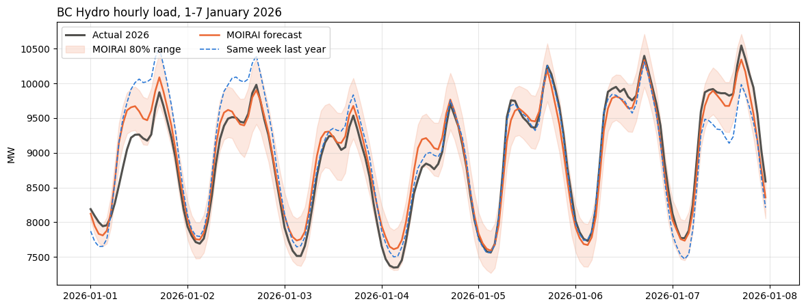
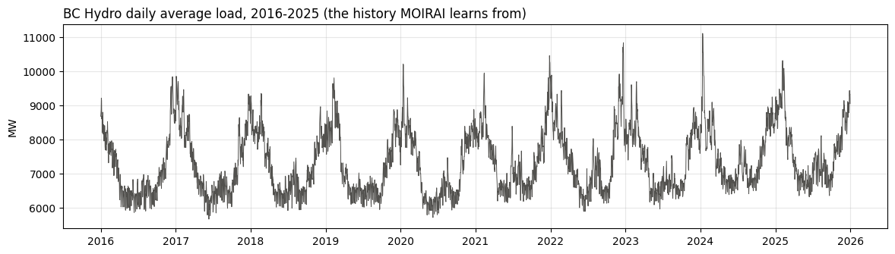

# BC Hydro Load Forecasting with Salesforce MOIRAI

SGST 9310 project: forecast BC Hydro's hourly load for **1-7 January 2026** with
[MOIRAI 2.0](https://huggingface.co/Salesforce/moirai-2.0-R-small) (zero-shot), then compare it with actual 2026 load.

## Notebook

[`MOIRAI/MOIRAI_Jan2026_Week1.ipynb`](MOIRAI/MOIRAI_Jan2026_Week1.ipynb)

1. Open it in Google Colab (File > Open notebook > GitHub, or upload it).
2. Runtime > Change runtime type > **T4 GPU**.
3. Put the BC Hydro `BalancingAuthorityLoad` files (2016-2025 plus 2026) in Google Drive at
   `MyDrive/Bchydrodata/Input`, or change `DATA_FOLDER` in step 2.
4. Runtime > Run all.

## What it does

- Reads 10 years of hourly BC Hydro load (2016-2025) and fixes daylight-saving hours.
- MOIRAI reads the last 48 weeks of history and forecasts 168 hours (1-7 Jan 2026) with an 80% range (P10-P90).
- Compares with actual 2026 load and a "same week last year" baseline: MAE, RMSE, MAPE, max error and a day-by-day table.

Data source: [BC Hydro historical transmission data](https://www.bchydro.com/energy-in-bc/operations/transmission/transmission-system/balancing-authority-load-data/historical-transmission-data.html)

## Results (1-7 January 2026)

### Forecast vs actual

Grey = actual 2026 load, orange = MOIRAI forecast, orange shading = 80% range (P10-P90), blue dashed = same week last year.

**What it shows:** MOIRAI follows the daily up-and-down pattern closely, and the actual load fell inside its 80% range in 92% of hours. It forecasts slightly too high on 1-4 Jan (including the New Year holiday, which it can't know about) and slightly too low on 5-7 Jan. It is closer than "same week last year" on 5 of the 7 days.

### History used (2016-2025)

### Accuracy (lower is better)

| Method | MAE (MW) | RMSE (MW) | MAPE (%) | Max error (MW) |
|---|---|---|---|---|
| **MOIRAI** | **161.98** | **202.03** | **1.84** | **627.67** |
| Same week last year | 253.32 | 331.14 | 2.80 | 848.00 |

**What the columns mean** (each compares the forecast with the actual load, hour by hour, over the 168 hours):
- **MAE (Mean Absolute Error):** the average size of the hourly miss, in MW. 162 MW means MOIRAI was off by about 162 MW in a typical hour.
- **RMSE (Root Mean Squared Error):** like MAE, but large misses count extra, so it shows whether there were a few big errors.
- **MAPE (Mean Absolute Percentage Error):** the average miss as a % of the actual load. 1.84% means about 2% off on average.
- **Max error:** the single worst hour of the week, in MW.
- **MW (megawatt):** the unit of electricity load (how much power BC is using at that moment).

MOIRAI's average hourly error is about 36% smaller than the "same week last year" baseline.

### Day by day (average MW)

| Day | Actual | MOIRAI | Last year | MOIRAI error (%) |
|---|---|---|---|---|
| Thu 01 Jan | 8825.5 | 9039.3 | 9217.7 | +2.4 |
| Fri 02 Jan | 8908.0 | 8969.1 | 9257.0 | +0.7 |
| Sat 03 Jan | 8574.5 | 8745.5 | 8767.0 | +2.0 |
| Sun 04 Jan | 8452.5 | 8675.8 | 8573.2 | +2.6 |
| Mon 05 Jan | 9052.5 | 8976.1 | 9025.8 | -0.8 |
| Tue 06 Jan | 9244.1 | 9122.0 | 9147.1 | -1.3 |
| Wed 07 Jan | 9315.0 | 9169.0 | 8868.4 | -1.6 |

Positive error = MOIRAI forecast too high.

See [MOIRAI/results/README.md](MOIRAI/results/README.md) for how to read each result.
